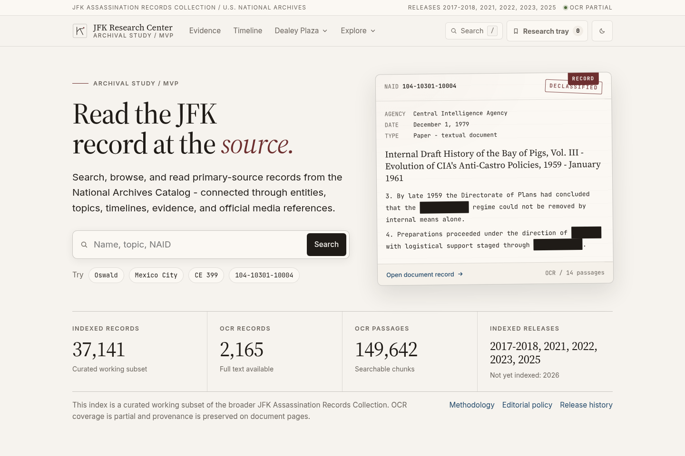
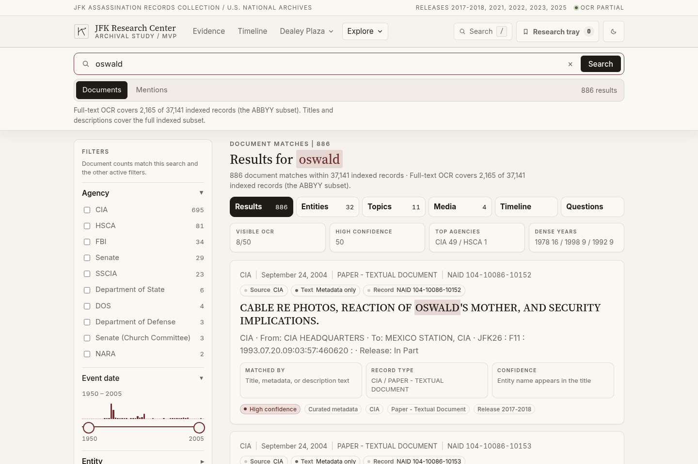
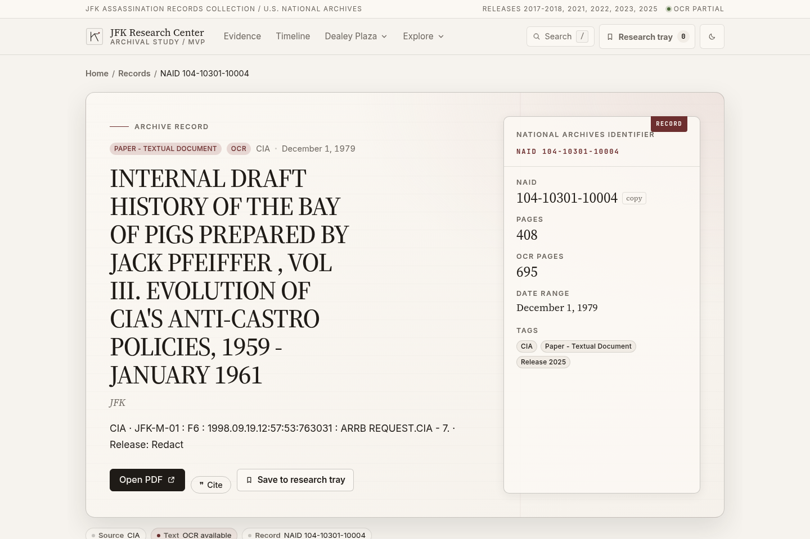
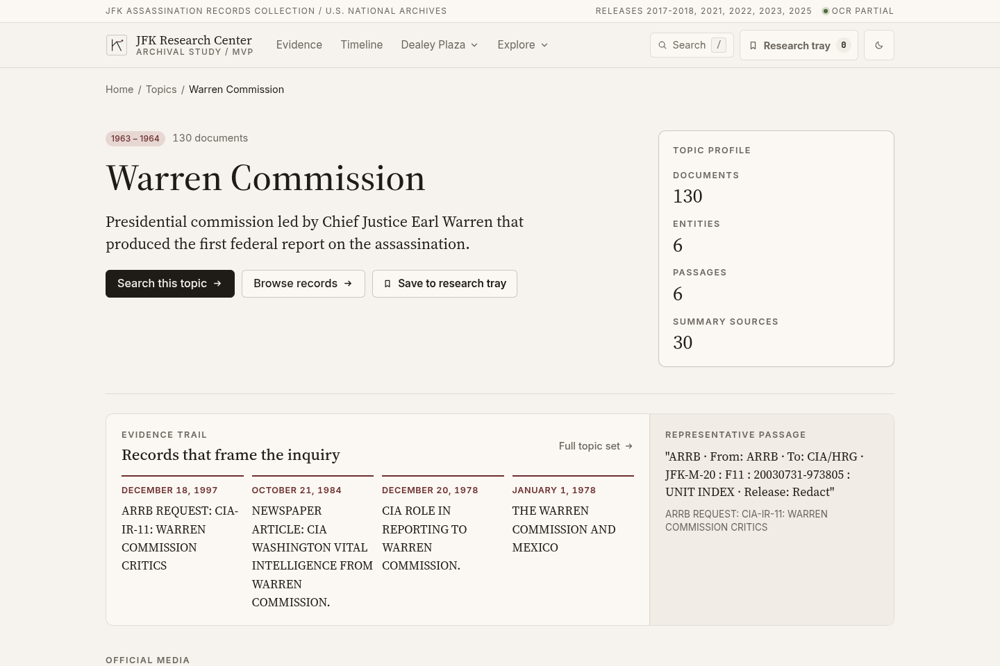
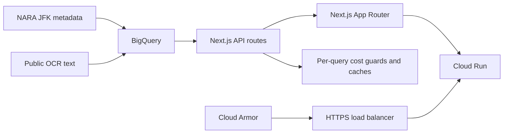

# JFK Research Center

Search, read, and connect primary-source JFK assassination records from the U.S. National Archives.

[](https://github.com/thejayer/jfk-research-center/actions/workflows/deploy.yml)
[](LICENSE)
[](https://researchjfk.ai)

**Live:** [researchjfk.ai](https://researchjfk.ai)



## Features

- **Archive search** — keyword search across 37,000+ indexed NARA records, with agency/year facets, confidence labels, and OCR excerpts when coverage exists.
- **Document reader** — page-at-a-time OCR for records that have text, plus NARA metadata, release history, and links to related topics and entities.
- **Topics and entities** — curated dossiers (Warren Commission, FBI, CIA, Dealey Plaza, and more) and profiles for people, agencies, and organizations.
- **Timeline and evidence** — case chronology, official exhibits, and a Dealey Plaza witness map with a trajectory sandbox for comparing published assumptions.
- **Official media pointers** — public JFK Library catalog references (metadata and eligibility notes; media files are not vendored in this repo).
- **Public JSON API** — first-party `/api/*` routes power the site; warehouse `/api/v1/*` routes require an API key and are rate-limited.
- **Cost and abuse guards** — per-query BigQuery byte caps, in-process search/document caches, crawler blocks, and per-route rate limits in front of warehouse work.







## Architecture

NARA JFK collection metadata and public OCR text are loaded into BigQuery. A Next.js App Router app reads that warehouse through server-side `/api/*` handlers, then runs on Cloud Run behind an HTTPS load balancer with Cloud Armor. Cost-sensitive routes apply byte caps, rate limits, and short-lived caches so a single search or document open cannot scan the full OCR corpus.



Warehouse SQL lives in `sql/`. Runtime guards live in `middleware.ts` and `lib/cost-controls.ts`.

## Data sources

Primary records in this project are **U.S. government works** from the National Archives and Records Administration (NARA). Those source records are in the **public domain**.

| Role | Source | Notes |
| --- | --- | --- |
| Record metadata | [NARA JFK Assassination Records Collection](https://www.archives.gov/research/jfk) release manifests (2017–2018, 2021, 2022, 2023, 2025) | Catalog identifiers, titles, agencies, dates, and release status for the indexed subset |
| Searchable OCR | [abbyy/JFK-OCR](https://github.com/abbyy/JFK-OCR) | Public OCR for a subset of RIFs; records without OCR fall back to NARA description text |
| Official media references | [JFK Library](https://www.jfklibrary.org/) public catalog metadata | Pointers and eligibility notes only; binaries are not vendored here |

Coverage is a curated working subset of the broader collection. OCR is partial and marked as machine-generated on document pages. Provenance (`abbyy_ocr` vs description) is retained in the warehouse.

## Local development

```bash
npm install
npm run dev:mock
```

Mock mode (`JFK_DATA_SOURCE=mock`) serves home, search, topic, entity, and document routes from local fixtures. It does not need cloud credentials.

To run against a BigQuery warehouse:

```bash
gcloud auth application-default login
export JFK_BQ_PROJECT=YOUR_GCP_PROJECT
npm run dev
```

The app listens on `http://localhost:3000`.

| Variable | Purpose |
| --- | --- |
| `JFK_BQ_PROJECT` | GCP project that hosts the warehouse (placeholder: `YOUR_GCP_PROJECT`) |
| `JFK_DATA_SOURCE` | `mock` for fixtures; omit or use any other value for BigQuery |
| `JFK_API_BASE_URL` | Optional override when pages should call a remote API host |
| `JFK_BQ_MAX_BYTES_BILLED` | Optional per-job BigQuery byte cap |
| `JFK_SEARCH_CACHE_TTL_SECONDS` | Optional in-process search cache lifetime |
| `JFK_API_KEYS` | Comma-separated keys for `/api/v1/*` warehouse routes |

Do not commit real keys, tokens, or credential files. See `docs/development-workflow.md` for the typecheck / test / build / accessibility gates.

### Scripts

| Script | Purpose |
| --- | --- |
| `npm run dev` | Next.js dev server (BigQuery by default) |
| `npm run dev:mock` | Dev server with local fixture data |
| `npm run typecheck` | `tsc --noEmit` |
| `npm run test` | Vitest |
| `npm run build` | Production build |
| `npm run start` | Serve the production build |
| `npm run audit:a11y` | Accessibility and layout regression gate |

## Project layout

```
app/           App Router pages and API routes
components/    Search, documents, topics, layout, and shared UI
lib/           Warehouse adapter, cost guards, API types, and tests
sql/           BigQuery SQL for curated and search tables
data/          Fixture snapshots used by mock mode
docs/          Workflow, cost, and API notes
```

## License

Code in this repository is released under the [MIT License](LICENSE).

NARA source records are U.S. government works and are in the public domain. OCR text from [abbyy/JFK-OCR](https://github.com/abbyy/JFK-OCR) remains subject to that repository’s license. Editorial summaries on topic pages are generated from the retrieved records and should be checked against the primary documents.
